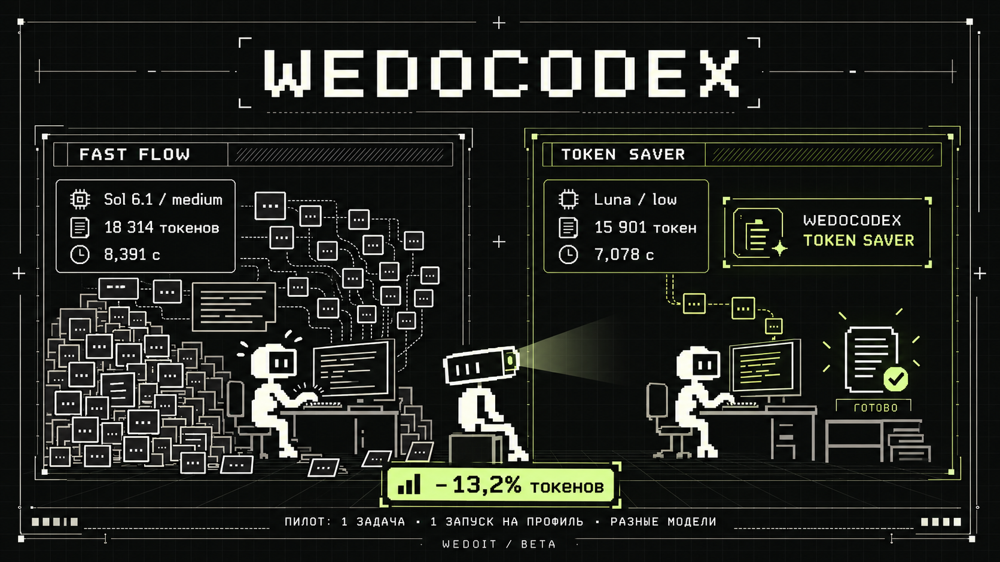

# WEDOCODEX 0.2.0-beta.3



Пять режимов Codex: экономия, быстрые правки, качество, чтение и длительные задачи. Независимый экспериментальный проект, не официальный продукт OpenAI.

Лицензия: [MIT](LICENSE). Разрешены использование, изменение и распространение, включая коммерческое, с сохранением уведомлений об авторстве и лицензии. Лицензия включена также в установленный навык.

## Установка

Нужны Python 3.11+ и Codex CLI. Проверено на Windows с CLI `0.162.0-alpha.17.2`. Другие ОС и версии пока не проверены. На Windows нужен нативный `codex.exe` в PATH. Запуск через npm-файлы `.cmd`/`.bat` отклоняется: текст задачи не передаётся командному интерпретатору.

Распакуйте архив в любую папку. Из неё:

```powershell
python wedocodex.py install
python wedocodex.py
```

Установка добавляет пять профилей в `$CODEX_HOME` (обычно `~/.codex`) и переносимый навык в `~/.agents/skills/wedocodex`. Основной `config.toml` не меняется. Отличающиеся существующие файлы блокируют установку до записи. Файлы и хеши отслеживаются в `wedocodex-install.json`; проверенные резервные копии и журналы операций сохраняются в `wedocodex-history` внутри CODEX_HOME.

Другие папки:

```powershell
python wedocodex.py install --home D:/CodexConfig --skills-dir D:/Skills
```

Произвольная папка навыков должна быть подключена к клиенту отдельно. С одним `--home` навык устанавливается в `<home>/skills` для изолированных тестов. Если навык уже есть в другой поддерживаемой клиентом папке, не создавайте дубликат.

В чате:

```text
$wedocodex
$wedocodex token-saver
```

Если навык не появился, перезапустите клиент. Вызов без режима показывает выбор. Обсуждение или проверка навыка не активирует режим.

## Обновление и удаление

Запускайте обновление из новой распакованной версии:

```powershell
python wedocodex.py update --dry-run
python wedocodex.py update
python wedocodex.py uninstall --dry-run
python wedocodex.py uninstall
```

Обновление и удаление проверяют хеши принадлежащих пакету файлов. Если файл изменён пользователем, операция целиком останавливается до изменений. Неизвестные файлы, основной config.toml и резервные копии остаются. Запись каждого файла атомарна; ошибка приводит к откату. Для прерванной операции есть `python wedocodex.py recover`. После аварийного завершения процесса lock может остаться: сначала проверьте, что установщик действительно остановлен; автоматически удалять lock нельзя.

У beta.1 нет манифеста владения. `migrate_legacy.py` принимает прежний ZIP, его заранее известный SHA-256 и папки установки. Он сверяет каждый старый файл перед регистрацией и обновлением; изменённая старая установка не мигрирует автоматически. Для незнакомых старых сборок сохраняйте резервную копию и устанавливайте отдельно.

## Режимы

| Режим | Модель / effort | Назначение |
|---|---|---|
| token-saver | GPT-6 Luna / low | Короткие ответы, точечное чтение, скрипты для рутины |
| fast-flow | GPT-6.1 Sol / medium | Без shell-эскалации, внутри workspace-write sandbox |
| max-quality | GPT-6 Astra / max | Сложные задачи и проверка существенных предположений |
| guarded | GPT-6.1 Sol / medium | Read-only sandbox, поведенческий запрет внешних изменений |
| autopilot | GPT-6.1 Sol / medium | Контрольные выжимки и терминальные уведомления |

Пресеты не гарантируют доступ к модели по вашему тарифу. Можно явно выбрать доступную модель и effort:

```powershell
python wedocodex.py show token-saver
python wedocodex.py run token-saver --workspace D:/Project --model AVAILABLE_MODEL --effort low
```

Запускатель проверяет сочетание по локальному `models_cache.json`. Если каталога нет или он повреждён, откройте обычный Codex для обновления. Каталог не доказывает доступ аккаунта; его подтверждает успешный ответ модели. Автоматической подмены модели нет.

Навык меняет поведение текущего чата. Модель, effort и разрешения меняются средствами клиента: в CLI `/model`, `/permissions`, проверка через `/status`. Полный пресет применяется при запуске новой CLI-сессии через меню. Продолжение — по точному ID после остановки предыдущего исполнителя:

```powershell
python wedocodex.py run max-quality --resume SESSION_ID --workspace D:/Project
```

Запускатель передаёт CLI overrides и инструкцию режима. Прямой `codex --profile wedocodex-token-saver` применяет только настройки; для поведения вызовите навык. Проектные настройки могут перекрыть прямой profile, но не overrides запускателя. Административные ограничения остаются выше. Запись конфиг-файла не переключает существующую сессию.

## Ограничения

- Guarded не изолирует все секреты и технически не блокирует изменения через все коннекторы: для них действует инструкция навыка.
- Fast Flow сохраняет sandbox. Запрещённые команды возвращают ошибку. Другие инструменты могут иметь собственные запросы подтверждения.
- Autopilot не создаёт планировщиков, не гарантирует бесконечную работу и не настраивает push на телефон. Уведомления зависят от терминала.
- Нет автоматических субагентов, дополнительных оплат или публикаций. Правила проекта сохраняются.
- Экономия не измерена. Compaction уменьшает контекст; скрытие reasoning не сокращает автоматически его расход.

## Исследование и второй тест

Официальные источники проверены 24 октября 2026, Europe/Moscow:

- [Configuration](https://learn.chatgpt.com/docs/config-file/config-advanced): отдельные профили и приоритет CLI overrides. Старый `[profiles.name]` не используется с 0.134.0.
- [Build skills](https://learn.chatgpt.com/docs/build-skills): переносимый SKILL.md с ресурсами рядом; плагины для распространения.
- [Developer commands](https://learn.chatgpt.com/docs/developer-commands?surface=cli): управление моделью, разрешениями и контекстом.
- [Model selection](https://developers.openai.com/api/docs/guides/model-selection): выбирать самую лёгкую конфигурацию, проходящую проверку на вашей задаче.
- [App Server](https://learn.chatgpt.com/docs/app-server): `config/read` возвращает загруженную конфигурацию.

Прошли 26 регрессионных тестов и 7 проверок конфигурации через отдельный локальный App Server. Добавлены сценарии обновления, удаления, отказа при пользовательских правках, блокировки параллельной установки, восстановления прерванной транзакции, миграции beta.1 и проверки путей манифеста.

```powershell
python -m unittest -v test_wedocodex test_release test_lifecycle
python verify_runtime.py
```

Эти автоматические тесты не вызывают inference. Дополнительно выполнены два реальных запроса через Codex CLI на одной задаче обработки данных. Оба ответа правильные: для запрошенного Luna/low — 15 865 входных и 36 выходных токенов, для Sol/medium — 18 252 и 62. Reasoning 0/24 уже входит в выходные токены. Суммарно первый запрос использовал на 13,2% меньше токенов; это одна проба, не статистический бенчмарк или обещание экономии. Различались также системные контексты моделей. Независимый ID фактически обслужившей модели CLI в этих событиях не сообщил, поэтому названия здесь — запрошенные настройки.

Два запроса заняли 7,1 и 8,4 секунды. Тестовый notify-обработчик получил событие завершения в обоих случаях; визуальная доставка терминального уведомления не проверена. Процент расхода подписки не используется как точная метрика: счётчик округляется, а тарифы различаются.

Linux/macOS оставлены непроверенными по решению владельца. Исполнение sandbox-команд, resume и широкий набор задач пока не проверены end-to-end. Статус пакета остаётся beta.

Перед стабильным релизом остаются расширенный замер, визуальная проверка уведомлений и дополнительные ОС. Начиная с beta.3 код распространяется под MIT; статус технической готовности остаётся beta.

Обложка создана с помощью ИИ по референсам WEDOIT. Сцена — иллюстрация идеи, а не скриншот или гарантия ускорения.
